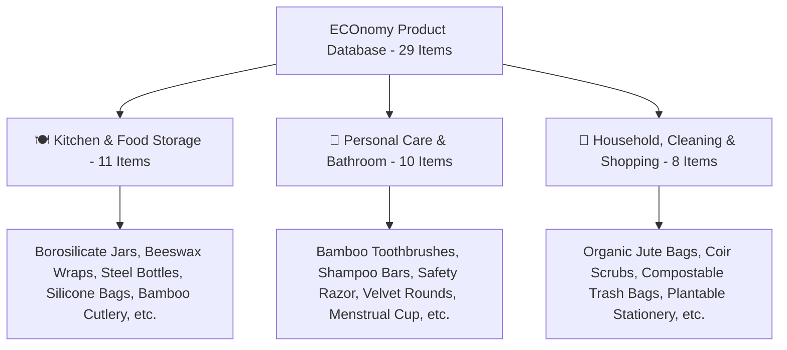
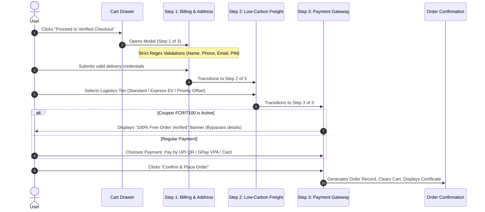

# 🌿 ECOnomy — Sustainable Lifestyle & Zero-Waste Circular E-Commerce

[](file:///Users/ajitsingh/Downloads/ECONOMY)
[](file:///Users/ajitsingh/Downloads/ECONOMY/app.js)
[](file:///Users/ajitsingh/Downloads/ECONOMY/products.js)
[](file:///Users/ajitsingh/Downloads/ECONOMY)
[](file:///Users/ajitsingh/Downloads/ECONOMY)
[](file:///Users/ajitsingh/Downloads/ECONOMY/LICENSE)

> **ECOnomy** is a responsive, biophilic, client-side circular e-commerce platform engineered for eco-conscious households, zero-waste advocates, and sustainable living enthusiasts. It bridges consumer intent with measurable ecological impact by combining transparent embodied carbon metrics, certified plastic-free alternatives, ergonomic UX design, and a multi-step checkout workflow with native UPI payment simulations.

Developed in alignment with the **HSSM301 Product Design Group Project** curriculum at **Fr. C. Rodrigues Institute of Technology (FCRIT), Navi Mumbai**, under the thematic pillars of **Circular Economics, Cradle-to-Cradle Consumption, and Non-Toxic Alternatives**.

---

## 📑 Table of Contents

- [🌿 ECOnomy — Sustainable Lifestyle \& Zero-Waste Circular E-Commerce](#-economy--sustainable-lifestyle--zero-waste-circular-e-commerce)
  - [📑 Table of Contents](#-table-of-contents)
  - [🎯 Project Overview \& Vision](#-project-overview--vision)
    - [The Challenge](#the-challenge)
    - [The Circular Economic Solution](#the-circular-economic-solution)
    - [Academic \& Practical Objectives](#academic--practical-objectives)
  - [📂 Repository Structure](#-repository-structure)
    - [File \& Asset Descriptions](#file--asset-descriptions)
  - [🛍️ Curated Sustainable Catalog (29 Products)](#️-curated-sustainable-catalog-29-products)
    - [1. 🍽️ Kitchen \& Food Storage (11 Products)](#1-️-kitchen--food-storage-11-products)
    - [2. 🛁 Personal Care \& Bathroom (10 Products)](#2--personal-care--bathroom-10-products)
    - [3. 🏡 Household, Cleaning \& Shopping (8 Products)](#3--household-cleaning--shopping-8-products)
  - [✨ Core Features \& Functional Architecture](#-core-features--functional-architecture)
    - [1. 🌲 Biophilic Hero Section](#1--biophilic-hero-section)
    - [2. 🔍 Dynamic Catalog Grid \& Real-Time Filtering](#2--dynamic-catalog-grid--real-time-filtering)
    - [3. 📄 Progressive Disclosure: Architectural Spec Sheet Modal](#3--progressive-disclosure-architectural-spec-sheet-modal)
    - [4. 🛒 Slide-Out Cart Drawer \& Live Carbon Offset Meter](#4--slide-out-cart-drawer--live-carbon-offset-meter)
    - [5. 🔒 Verified 3-Step Green Checkout Workflow](#5--verified-3-step-green-checkout-workflow)
    - [6. 📜 Order Confirmation \& Digital Carbon Certificate](#6--order-confirmation--digital-carbon-certificate)
    - [7. 🧮 Interactive Project Carbon \& LEED Calculator](#7--interactive-project-carbon--leed-calculator)
    - [8. 📱 Thumb-Zone Mobile Ergonomics \& Accessibility](#8--thumb-zone-mobile-ergonomics--accessibility)
  - [🧠 Technical Architecture \& State Management](#-technical-architecture--state-management)
    - [Application State Schema (`STATE`)](#application-state-schema-state)
    - [LocalStorage Synchronization Engine](#localstorage-synchronization-engine)
    - [Rigorous Form Validation Matrix](#rigorous-form-validation-matrix)
    - [Pricing, Discount \& Carbon Calculation Formulae](#pricing-discount--carbon-calculation-formulae)
  - [🚀 Setup \& Installation Guide](#-setup--installation-guide)
    - [Prerequisites](#prerequisites)
    - [Option 1: Instant Browser Launch (Zero-Install)](#option-1-instant-browser-launch-zero-install)
    - [Option 2: PowerShell Local Server (`start-server.ps1`)](#option-2-powershell-local-server-start-serverps1)
    - [Option 3: Python Built-In HTTP Server (macOS / Linux / Windows)](#option-3-python-built-in-http-server-macos--linux--windows)
    - [Option 4: Node.js (`npx serve`)](#option-4-nodejs-npx-serve)
    - [Option 5: VS Code / Cursor "Live Server" Extension](#option-5-vs-code--cursor-live-server-extension)
    - [Option 6: Docker Containerization (Nginx)](#option-6-docker-containerization-nginx)
  - [🧪 Demonstration \& Verification Walkthrough](#-demonstration--verification-walkthrough)
  - [🎨 Design System \& Ergonomic Guidelines](#-design-system--ergonomic-guidelines)
  - [🎓 Academic Context \& Credits](#-academic-context--credits)

---

## 🎯 Project Overview & Vision

### The Challenge
Modern consumer habits are heavily dominated by a **linear "take-make-waste" model**. Everyday kitchenware, personal grooming items, and home utilities are predominantly fabricated with single-use plastics, petroleum-derived synthetics, and toxic packaging that persist in landfills for centuries. Furthermore, traditional e-commerce platforms offer zero visibility into the embodied carbon or environmental impact of consumer purchases.

### The Circular Economic Solution
**ECOnomy** re-imagines e-commerce through the lens of **Circular Economics**:
- **Material Circularity**: Highlighting products crafted from renewable bamboo, food-grade borosilicate glass, GOTS-certified organic cotton, sustainably tapped beeswax, and plant-based biopolymers.
- **Embodied Carbon Transparency**: Every single item in the store discloses its **net carbon offset** (`-X.X kg CO2e / unit`), calculated against conventional high-emission petroleum counterparts.
- **Real-Time Carbon Accounting**: An integrated meter dynamically aggregates total carbon savings inside the user's cart and generates an official **Digital Embodied Carbon Offset Certificate** upon order placement.
- **Zero-Waste Life Cycle**: Supporting products designed for infinite recycling, backyard compostability, or multi-year reuse cycles.

### Academic & Practical Objectives
1. Implement a clean, performant, dependency-free frontend using modern **HTML5 semantic landmarks** and **ES6+ JavaScript modules**.
2. Design a cohesive biophilic aesthetic utilizing modern CSS typography, glassmorphism, and responsive CSS grid architectures.
3. Apply human-computer interaction (HCI) ergonomics: thumb-zone mobile navigation, 48px minimum touch targets, and accessible keyboard navigation.
4. Provide a simulated verified multi-step checkout with comprehensive client-side form validation and multi-gateway payment flows (UPI QR Code, Google Pay VPA, and Credit/Debit cards).

---

## 📂 Repository Structure

The project has been organized with a flat, modular architecture that ensures maximum portability, rapid prototyping, and zero dependency build steps:

```
ECONOMY/
├── index.html                   # Core single-page application structure & modals (1,033 lines)
├── app.js                       # Frontend reactive engine, state, checkout & calculations (1,448 lines)
├── products.js                  # Product database containing 29 curated zero-waste records (715 lines)
├── styles.css                   # Custom design system tokens, typography & animations (155 lines)
├── start-server.ps1             # Native PowerShell HTTP server script with auto-browser launch (76 lines)
├── hero-eco-lifestyle.jpg       # High-resolution lifestyle showcase image (283 KB)
├── tropical-leaves-overlay.jpg  # Biophilic foliage hero background texture (388 KB)
└── README.md                    # In-depth architectural documentation & setup guide
```

### File & Asset Descriptions

| File / Asset | Size / LOC | Responsibility & Role |
| :--- | :--- | :--- |
| [`index.html`](file:///Users/ajitsingh/Downloads/ECONOMY/index.html) | 1,033 lines | Primary HTML document. Contains the semantic layout, sticky header, biophilic hero section, reactive divisions banner, product grid viewport, impact calculator, slide-out cart drawer, multi-step checkout modal, order confirmation modal, quick spec sheet modal, and mobile bottom navigation bar. |
| [`app.js`](file:///Users/ajitsingh/Downloads/ECONOMY/app.js) | 1,448 lines | Main JavaScript application controller. Manages client state (`STATE`), handles `localStorage` synchronization, dynamic catalog filtering and sorting, cart mutations, progressive disclosure modals, strict form validation regexes, UPI/GPay tab switching, promo code evaluation, and LCA project calculations. |
| [`products.js`](file:///Users/ajitsingh/Downloads/ECONOMY/products.js) | 715 lines | Comprehensive data store (`PRODUCTS_DATA`). Defines 29 sustainable products across 3 divisions with pricing in INR (₹), ratings, carbon offsets, live stock quantities, third-party certifications, and technical specification sheets. |
| [`styles.css`](file:///Users/ajitsingh/Downloads/ECONOMY/styles.css) | 155 lines | Design system stylesheet. Imports Google Fonts (*Outfit*, *Plus Jakarta Sans*, *Space Grotesk*), defines CSS custom properties, custom scrollbars, drawer animation curves, range slider ergonomics, product card hover transitions, and `@media print` rules for physical receipt manifests. |
| [`start-server.ps1`](file:///Users/ajitsingh/Downloads/ECONOMY/start-server.ps1) | 76 lines | Built-in zero-dependency local HTTP server written in PowerShell using `.NET System.Net.HttpListener`. Automatically handles MIME types and opens the default browser to `http://localhost:8080/`. |
| [`tropical-leaves-overlay.jpg`](file:///Users/ajitsingh/Downloads/ECONOMY/tropical-leaves-overlay.jpg) | 388 KB | Ambient botanical background texture layered under the hero section with screen-blend mode and directional slate gradients for WCAG-compliant contrast. |
| [`hero-eco-lifestyle.jpg`](file:///Users/ajitsingh/Downloads/ECONOMY/hero-eco-lifestyle.jpg) | 283 KB | Curated visual asset depicting organic home lifestyle and zero-waste storage accessories. |

---

## 🛍️ Curated Sustainable Catalog (29 Products)

The catalog database is divided into three core sustainable divisions comprising **29 meticulously researched products**:



### 1. 🍽️ Kitchen & Food Storage (11 Products)

| ID | Product Name | Unit / Pack | Price (₹) | Rating | Carbon Saved | Certifications |
| :--- | :--- | :--- | :--- | :--- | :--- | :--- |
| `kitchen-01` | Borosilicate Glass Jars with Bamboo Lids | Set of 3 | ₹699.00 | 4.9 ★ | `-4.2 kg CO2e` | 100% Plastic-Free, Lead-Free |
| `kitchen-02` | Natural Organic Beeswax Food Wraps | Pack of 3 (S/M/L) | ₹449.00 | 5.0 ★ | `-3.8 kg CO2e` | GOTS Certified Organic, Backyard Compostable |
| `kitchen-03` | Insulated Stainless Steel Containers & Bottle | Unit (750ml) | ₹899.00 | 4.8 ★ | `-6.5 kg CO2e` | Food-Grade 304 Steel, BPA & Toxin Free |
| `kitchen-04` | Reusable Platinum Food-Grade Silicone Bags | Set of 2 | ₹549.00 | 4.7 ★ | `-3.2 kg CO2e` | 100% Platinum Silicone, LFGB Food Safe |
| `kitchen-05` | Handcrafted Bamboo & Wood Utensils & Cutlery | Set of 6 | ₹349.00 | 4.9 ★ | `-2.8 kg CO2e` | FSC Certified Bamboo, Food-Grade Mineral Oil |
| `kitchen-06` | Areca Leaf & Sugarcane Bagasse Tableware | Pack of 25 | ₹299.00 | 4.8 ★ | `-4.0 kg CO2e` | 100% Fallen Leaf, Home Compostable (60 Days) |
| `kitchen-07` | Airtight Stainless Steel Bento Lunchbox | Unit (1200ml) | ₹799.00 | 4.8 ★ | `-5.2 kg CO2e` | 304 Food-Grade Steel, Zero Plastic Clasps |
| `kitchen-08` | Pure Hammered Ayurvedic Copper Water Pitcher | Unit (1500ml) | ₹1,299.00 | 4.9 ★ | `-7.1 kg CO2e` | 100% Pure Copper, Ancient Ayurvedic Craft |
| `kitchen-09` | Hand-Carved Natural Reclaimed Coconut Bowls | Set of 2 + Spoons | ₹399.00 | 4.7 ★ | `-2.4 kg CO2e` | 100% Upcycled Shells, Biodegradable |
| `kitchen-10` | French Press Coffee Maker (Borosilicate & Steel) | Unit (600ml) | ₹949.00 | 4.8 ★ | `-4.8 kg CO2e` | Zero Paper Filters, Thermal Shock Glass |
| `kitchen-11` | Unbleached Organic Linen & Cotton Bread Bags | Set of 2 | ₹329.00 | 4.6 ★ | `-1.9 kg CO2e` | 100% GOTS Unbleached Linen, Zero Microfibers |

### 2. 🛁 Personal Care & Bathroom (10 Products)

| ID | Product Name | Unit / Pack | Price (₹) | Rating | Carbon Saved | Certifications |
| :--- | :--- | :--- | :--- | :--- | :--- | :--- |
| `care-01` | Biodegradable Bamboo Toothbrushes with Charcoal | Pack of 4 | ₹249.00 | 4.9 ★ | `-1.8 kg CO2e` | 100% Moso Bamboo, Castor Bean Bristles |
| `care-02` | Solid Shampoo, Conditioner & Body Soap Bars | Set of 3 Bars | ₹399.00 | 4.8 ★ | `-3.4 kg CO2e` | Zero Bottle Waste, Sulfate & Palm-Oil Free |
| `care-03` | Precision Metal Safety Razor with 10 Blades | Set (Brass Razor) | ₹799.00 | 5.0 ★ | `-5.6 kg CO2e` | Lifetime Solid Brass, Zero Plastic Cartridges |
| `care-04` | Reusable Bamboo Velvet Facial Cleansing Rounds | Pack of 16 + Bag | ₹349.00 | 4.7 ★ | `-2.1 kg CO2e` | GOTS Organic Cotton, Replaces 1000+ Disposables |
| `care-05` | Medical-Grade Silicone Menstrual Cup | Unit + Pouch | ₹599.00 | 5.0 ★ | `-8.5 kg CO2e` | 100% Medical-Grade Silicone, 10-Year Lifespan |
| `care-06` | Handcrafted Wooden Wide-Tooth Neem Comb | Pack of 2 | ₹199.00 | 4.7 ★ | `-1.2 kg CO2e` | 100% Herbal Neem Wood, Anti-Static |
| `care-07` | Natural Loofah Body Scrubbers & Exfoliators | Pack of 3 | ₹219.00 | 4.6 ★ | `-1.5 kg CO2e` | 100% Natural Luffa Plant, Backyard Compostable |
| `care-08` | Charcoal Dental Floss with Refillable Glass Jar | 2x 30m Spools | ₹279.00 | 4.8 ★ | `-1.6 kg CO2e` | Bamboo Charcoal Fiber, Candelilla Wax Coated |
| `care-09` | Natural Konjac Facial Cleansing Sponge | Pack of 2 | ₹269.00 | 4.7 ★ | `-1.1 kg CO2e` | 100% Pure Konjac Root, 100% Biodegradable |
| `care-10` | Mineral Sunscreen in Recyclable Tin (SPF 50) | 100g Tin | ₹499.00 | 4.8 ★ | `-2.9 kg CO2e` | Non-Nano Zinc Oxide, Reef-Safe & Cruelty-Free |

### 3. 🏡 Household, Cleaning & Shopping (8 Products)

| ID | Product Name | Unit / Pack | Price (₹) | Rating | Carbon Saved | Certifications |
| :--- | :--- | :--- | :--- | :--- | :--- | :--- |
| `house-01` | Heavy-Duty Organic Cotton & Jute Shopping Bags | Set of 3 | ₹399.00 | 4.9 ★ | `-4.5 kg CO2e` | GOTS Organic Canvas, 15kg Tensile Strength |
| `house-02` | Coconut Coir Dish Scrubs & Bottle Brushes | Pack of 5 | ₹229.00 | 4.8 ★ | `-2.3 kg CO2e` | Upcycled Coconut Fiber, Zero Microplastics |
| `house-03` | 100% Plant-Based Compostable Trash Bags | Roll of 30 | ₹349.00 | 4.9 ★ | `-3.9 kg CO2e` | ASTM D6400 / EN 13432 Certified |
| `house-04` | Plantable Seed-Embedded Recycled Stationery | Kit | ₹299.00 | 5.0 ★ | `-2.0 kg CO2e` | 100% Post-Consumer Cotton Rag Paper |
| `house-05` | 100% Pure New Zealand Wool Dryer Balls | Pack of 6 | ₹449.00 | 4.8 ★ | `-3.6 kg CO2e` | Organic Wool, Reduces Drying Time by 25% |
| `house-06` | Dissolvable Laundry Detergent Eco-Sheets | Pack of 60 Sheets | ₹399.00 | 4.9 ★ | `-4.8 kg CO2e` | Zero Plastic Jugs, Plant-Derived Enzymes |
| `house-07` | Natural Aromatic Cedar Wood Moth Repellent Blocks | Pack of 12 | ₹279.00 | 4.6 ★ | `-1.7 kg CO2e` | 100% Natural Red Cedar, Chemical Free |
| `house-08` | Upcycled Denim & Cotton Rag Floor Cushions | Unit (18"x18") | ₹649.00 | 4.8 ★ | `-5.4 kg CO2e` | 100% Upcycled Post-Consumer Textile Waste |

---

## ✨ Core Features & Functional Architecture

### 1. 🌲 Biophilic Hero Section
- **Layered Visual Depth**: Atmospheric hero combining a high-resolution tropical botanical overlay (`tropical-leaves-overlay.jpg`) blended with directional dark slate gradients (`#030712`) and emerald glows.
- **Strict Baseline Typography**: Built on an 8px grid hierarchy using *Outfit* and *Plus Jakarta Sans*.
- **WCAG 2.1 AA Compliant**: Carefully calibrated color contrasts ensuring high legibility.
- **Direct Ergonomic Action**: High-contrast primary call-to-action button directing users to the catalog.

### 2. 🔍 Dynamic Catalog Grid & Real-Time Filtering
- **Fluid Multi-Column Responsive Grid**: Expands dynamically from 1 column on mobile devices up to 5 columns on ultra-wide screens (`min-[1850px]:grid-cols-5`).
- **Interactive Division Switching**: Instant client-side switching between **All Items (29)**, **Kitchen (11)**, **Personal Care (10)**, and **Household (8)** without page reloads.
- **Multi-Factor Sorting Engine**:
  - `featured`: Curated standard layout.
  - `price-low`: Lowest to highest price (₹).
  - `price-high`: Highest to lowest price (₹).
  - `rating`: Highest eco-rating (1.0 to 5.0).
  - `carbon`: Highest embodied carbon offset (kg CO2e).
- **Rich Product Cards**:
  - Zoom-on-hover imagery.
  - Active stock badge with live inventory counters.
  - Embodied carbon offset badge (`-X.X kg CO2e / unit`).
  - Interactive Wishlist heart toggle with instant toast notification.
  - Dual action targets: **Quick Spec Sheet** (secondary outline) and **Add to Cart** (primary emerald).

### 3. 📄 Progressive Disclosure: Architectural Spec Sheet Modal
Clicking **Specs** on any product triggers a deep architectural disclosure modal rendering engineering-grade material parameters:
- **Dimensions & Capacity** (e.g., sizes, volume, closure specs).
- **Durability & Thermal Thresholds** (temperature limits, dishwasher/microwave safety).
- **Safety, Fire & Mineral Ratings** (non-porous mineral qualities, antibacterial traits).
- **VOC & Chemical Emission Testing** (lead-free, phthalate-free, BPA/BPS-free, 0.0% synthetic fillers).
- **Circular & Recycled Content %** (e.g., 100% post-consumer upcycled content, infinite recyclability).
- **LEED v4.1 & Environmental Credit Alignment** (plastic reduction benchmarks, single-use elimination).
- **Provenance & Regional Origin** (responsible zero-emission artisanal sources, fair-trade certified mills).
- **Direct Modal Purchase Controls**: Stepper controls to select quantity and add directly into the cart.

### 4. 🛒 Slide-Out Cart Drawer & Live Carbon Offset Meter
- **Off-Canvas Drawer Pattern**: Accessible via sticky desktop header or mobile navigation bar.
- **Live Carbon Offset Banner**: Displays an animated, real-time aggregate of total CO2e diverted from landfills across all selected items.
- **Session State Persistence**: Automatically synchronized to browser `localStorage` (`economy_cart_v2`).
- **Promotional Voucher Engine**:
  - `FCRIT100`: Special academic evaluator code providing **100% total order waiver** (₹0.00 total) and unlocking the instant zero-bill checkout path.
  - `GREENBUILD15`: 15% discount on material subtotals.
  - `ECOHERO`: ₹25 fixed environmental credit voucher.
- **Dynamic Cost Breakdown**: Subtotal, applicable promo discounts, selectable shipping tiers, 8.75% sustainable logistics tax, and final grand total.

### 5. 🔒 Verified 3-Step Green Checkout Workflow
The checkout workflow features a modal with step navigation:



#### Step 1: Billing & Delivery Destination
Implements strict field-level input constraints and live error handling:
- **Full Name**: Alphabetic validation (`/^[a-zA-Z\s'. -]{2,}$/`). Numbers and integers are blocked on keystroke.
- **Email Address**: Strict RFC validation. Must contain `@`, leading username, and valid top-level domain.
- **Mobile Number**: Numeric digits only, capped at **exactly 10 digits**. Alphabets and special characters are stripped.
- **Street Address**: Minimum length enforced.
- **City & State**: Strictly alphabetic. Numbers blocked on input.
- **PIN Code**: Exactly **6 numeric digits** (`/^\d{6}$/`). Alphabets are stripped automatically.

#### Step 2: Low-Carbon Freight Logistics
- **Standard Consolidated Eco-Freight**: FREE on orders over ₹150 (or ₹14.99). Grouped electric/biodiesel batch dispatch (5-7 days).
- **Low-Carbon Express**: ₹18.50. Regional rail transit combined with EV last-mile hub dispatch (2-3 days).
- **Priority Carbon-Neutral Overnight**: ₹32.00. 100% Gold Standard verified reforestation offset included.

#### Step 3: Zero-Carbon Payment Integration
- **Pay by QR Code**: Simulated high-resolution SVG QR code with central leaf branding. Supports UPI apps (**Google Pay, PhonePe, Paytm, BHIM, CRED**) with copyable UPI ID (`fcrit.economy@upi`).
- **Google Pay Direct VPA**: Dedicated UPI ID input with quick bank selector buttons (`@okhdfcbank`, `@oksbi`, `@okicici`, `@okaxis`).
- **Cards / Net Banking**: Formatted card number with space grouping, MM/YY expiry, and CVV masking.
- **Instant Zero-Bill Path**: If coupon `FCRIT100` was applied in the cart, a banner displays confirming zero payment requirement.

### 6. 📜 Order Confirmation & Digital Carbon Certificate
Upon completing checkout, an order confirmation screen renders:
- **Unique Order Reference**: Auto-generated sequential hash (e.g., `ECO-492108`).
- **Itemized Manifest**: Complete list of materials, quantities, and line item costs.
- **Dynamic Delivery Date**: Automatically calculated arrival date (+5 days).
- **Interactive Transit Progress Tracker**: Visual 4-node status indicator (Processed → FSC Inspected → Low-Emission Transit → On Site Delivery).
- **Digital Embodied Carbon Offset Certificate**: Highlights the exact kilograms of CO2e diverted by the order.
- **Print Optimization**: A dedicated "Print Specification Receipt" button formatted with print media queries (`@media print`) to generate clean, printer-friendly order documentation.

### 7. 🧮 Interactive Project Carbon & LEED Calculator
A dedicated analytical tool designed for architects, green builders, and households:
- **Project Surface Area Input**: Sliders and numerical inputs in square feet (50 to 50,000+ sq.ft).
- **Replacement Material Strategies**:
  - *Mass Timber / Barn Wood vs. Virgin Concrete & Steel* (4.8 kg CO2e / sq.ft offset factor)
  - *Strand-Woven Bamboo vs. Traditional Hardwood* (3.5 kg CO2e / sq.ft offset factor)
  - *Natural Hemp Batt vs. Petroleum Fiberglass* (2.9 kg CO2e / sq.ft offset factor)
  - *Living Sedum Roof & Solar vs. Traditional Asphalt* (5.2 kg CO2e / sq.ft offset factor)
- **Life Cycle Assessment (LCA) Output**:
  - Estimated embodied carbon saved (kg CO2e).
  - Equivalent mature tree seedlings grown for 10 years.
  - Estimated LEED v4.1 Materials & Resources (MR) credit contribution points (+1 to +5 points).
  - Adherence disclosure: Computations align with ISO 21930 and EN 15804 Cradle-to-Grave principles.

### 8. 📱 Thumb-Zone Mobile Ergonomics & Accessibility
- **8px Spatial System**: All padding, margins, line heights, and container dimensions align to an 8-pixel rhythm.
- **48px Minimum Hitboxes**: All interactive elements utilize `.touch-target-min` to ensure compliance with human thumb ergonomic guidelines.
- **Mobile Bottom Navigation Bar**: Sticky 4-tab bar (Home, Shop, Impact, Cart with real-time badge) for one-handed mobile navigation.
- **Accessible Keyboard & Focus Management**: Pressing the `Esc` key automatically closes all open drawers, spec sheets, and checkout modals.
- **Reactive Toast Notification System**: Animated bottom-right feedback notifications for wishlisting, cart adjustments, and form alerts.

---

## 🧠 Technical Architecture & State Management

### Application State Schema (`STATE`)

The application's runtime logic in [`app.js`](file:///Users/ajitsingh/Downloads/ECONOMY/app.js) is driven by a single state object:

```javascript
const STATE = {
  cart: [],                  // Array of active cart items { id, name, price, unit, qty, carbonOffset, image }
  wishlist: new Set(),       // Set of product IDs marked as favorite
  activeDivision: 'all',     // 'all' | 'kitchen' | 'personal-care' | 'household'
  searchQuery: '',           // Dynamic search query string
  maxPrice: Infinity,        // Upper bound price filter
  minEcoRating: 0,           // Lower bound eco-rating threshold
  activeCertifications: new Set(), // Set of required certification tags
  inStockOnly: false,        // Boolean flag for stock filtering
  sortBy: 'featured',        // 'featured' | 'price-low' | 'price-high' | 'rating' | 'carbon'
  appliedPromo: null,        // { code, type, value, label }
  shippingTier: 'standard',  // 'standard' | 'express' | 'overnight'
  paymentMethod: 'qr',       // 'qr' | 'gpay' | 'card'
  checkoutStep: 1,           // 1 | 2 | 3
  completedOrders: []        // Array of finalized order records
};
```

### LocalStorage Synchronization Engine

Persistent user sessions are maintained using `localStorage` across page refreshes and browser restarts:

```javascript
const STORAGE_KEYS = {
  CART: 'economy_cart_v2',
  ORDERS: 'economy_orders_v2',
  WISHLIST: 'economy_wishlist_v2'
};
```

### Rigorous Form Validation Matrix

The checkout engine enforces rigorous field-level regex rules inside `validateBillingField(fieldId)`:

| Field Identifier | Rule / Constraint | Regex Pattern | Error Feedback |
| :--- | :--- | :--- | :--- |
| `ship-name` | Mandatory, strictly alphabets, spaces, apostrophes, hyphens (no numbers) | `/^[a-zA-Z\s'. -]{2,}$/` | *"Name must not contain numbers/integers."* |
| `ship-email` | Valid RFC format, mandatory `@`, domain suffix | `/^[a-zA-Z0-9._%+-]+@[a-zA-Z0-9.-]+\.[a-zA-Z]{2,}$/` | *"Please enter a complete, valid email with a domain."* |
| `ship-phone` | Mandatory, digits only, exact length of 10 digits | `/^\d{10}$/` | *"Phone number must be exactly 10 digits."* |
| `ship-address` | Mandatory, minimum 5 characters | `val.length >= 5` | *"Please provide a complete street address (minimum 5 characters)."* |
| `ship-city` | Mandatory, strictly alphabetic (no numbers) | `/^[a-zA-Z\s'. -]{2,}$/` | *"City must contain alphabets only."* |
| `ship-state` | Mandatory, strictly alphabetic (no numbers) | `/^[a-zA-Z\s'. -]{2,}$/` | *"State must contain alphabets only."* |
| `ship-zip` | Mandatory, digits only, exact length of 6 digits (Indian PIN) | `/^\d{6}$/` | *"PIN Code must be exactly 6 numeric digits."* |

### Pricing, Discount & Carbon Calculation Formulae

In `calculateCartTotals()`:

$$\text{Subtotal} = \sum_{i=1}^{n} (\text{Price}_i \times \text{Qty}_i)$$

$$\text{Discount} = \begin{cases} 
\text{Subtotal} & \text{if Promo is } \texttt{FCRIT100} \\
\text{Subtotal} \times 0.15 & \text{if Promo is } \texttt{GREENBUILD15} \\
\min(\text{Subtotal}, 25.00) & \text{if Promo is } \texttt{ECOHERO} \\
0 & \text{otherwise}
\end{cases}$$

$$\text{Taxable Amount} = \max(0, \text{Subtotal} - \text{Discount})$$

$$\text{Tax} = \text{Taxable Amount} \times 0.0875 \quad (8.75\% \text{ Sustainable Logistics Tax})$$

$$\text{Grand Total} = \begin{cases} 
0.00 & \text{if Promo is } \texttt{FCRIT100} \\
\max(0, \text{Taxable Amount} + \text{Shipping Cost} + \text{Tax}) & \text{otherwise}
\end{cases}$$

$$\text{Total Embodied Carbon Saved} = \sum_{i=1}^{n} (\text{CarbonOffset}_i \times \text{Qty}_i) \quad [\text{kg CO}_2\text{e}]$$

---

## 🚀 Setup & Installation Guide

ECOnomy is built with **zero external build steps** or transpilation requirements. It can run immediately in any modern web browser or be served via a lightweight HTTP server.

### Prerequisites
- Any modern web browser (Google Chrome, Microsoft Edge, Mozilla Firefox, Safari, Brave).
- Optional: Python 3, Node.js, PowerShell, or Docker for local hosting.

---

### Option 1: Instant Browser Launch (Zero-Install)
You can run the application directly from the local filesystem:

- **macOS**:
  ```bash
  open /Users/ajitsingh/Downloads/ECONOMY/index.html
  ```
- **Windows**:
  Double-click `index.html` in File Explorer, or run in Command Prompt / PowerShell:
  ```powershell
  start index.html
  ```
- **Linux**:
  ```bash
  xdg-open index.html
  ```

---

### Option 2: PowerShell Local Server (`start-server.ps1`)
The repository includes a dedicated PowerShell script ([`start-server.ps1`](file:///Users/ajitsingh/Downloads/ECONOMY/start-server.ps1)) utilizing `.NET System.Net.HttpListener`:

1. Open PowerShell and navigate to the project directory:
   ```powershell
   cd /Users/ajitsingh/Downloads/ECONOMY
   ```
2. Run the script:
   ```powershell
   .\start-server.ps1 -Port 8080
   ```
3. The script will output server status and automatically launch your browser at:
   ```
   http://localhost:8080/
   ```

---

### Option 3: Python Built-In HTTP Server (macOS / Linux / Windows)
If you have Python installed, this is the quickest command-line method:

```bash
# Navigate to the project directory
cd /Users/ajitsingh/Downloads/ECONOMY

# Start local server on port 8080 (or any free port)
python3 -m http.server 8080
```
Open your browser and navigate to:
```
http://localhost:8080/
```

*(Note: On older systems with Python 2, use `python -m SimpleHTTPServer 8080`)*

---

### Option 4: Node.js (`npx serve`)
If you have Node.js installed, you can use `npx` without installing any packages globally:

```bash
cd /Users/ajitsingh/Downloads/ECONOMY
npx serve . -p 8080
```
Or using `http-server`:
```bash
npx http-server -p 8080 -c-1
```

---

### Option 5: VS Code / Cursor "Live Server" Extension
1. Open the `/Users/ajitsingh/Downloads/ECONOMY` folder in **Visual Studio Code** or **Cursor**.
2. Install the **Live Server** extension (by Ritwick Dey).
3. Right-click on [`index.html`](file:///Users/ajitsingh/Downloads/ECONOMY/index.html) and select **"Open with Live Server"**.
4. The page will open at `http://127.0.0.1:5500/index.html` with hot reloading enabled.

---

### Option 6: Docker Containerization (Nginx)
To package and deploy ECOnomy as a production-grade container:

1. Create a `Dockerfile` in the root directory:
   ```dockerfile
   FROM nginx:alpine
   COPY . /usr/share/nginx/html
   EXPOSE 80
   CMD ["nginx", "-g", "daemon off;"]
   ```
2. Build the Docker image:
   ```bash
   docker build -t economy-app:latest .
   ```
3. Run the container:
   ```bash
   docker run -d -p 8080:80 --name economy-container economy-app:latest
   ```
4. Access the application at `http://localhost:8080/`.

---

## 🧪 Demonstration & Verification Walkthrough

To experience the full capabilities of the platform during evaluations or presentations, follow this step-by-step walkthrough:

```
1. Explore Catalog
   ├── Click "🍽️ Kitchen & Food Storage (11)" filter button
   └── Sort by "Highest Carbon Offset"
        │
2. Inspect Deep Specifications
   ├── Click "Specs" button on "Borosilicate Glass Jars"
   ├── Review thermal limits (-20°C to 150°C) & zero-emission glass origin
   └── Click "+ Add to Project Cart" inside the modal
        │
3. Calculate Ecological Impact
   ├── Scroll down to "Interactive Project Carbon Calculator"
   ├── Change square footage to 2,500 sq.ft
   ├── Select "Mass Timber vs Virgin Concrete & Steel"
   └── Observe: 12,000 kg CO2e saved, 552 tree equivalent, +4 LEED points
        │
4. Cart Drawer & Promo Code
   ├── Click the green "Project Cart" button in the header
   ├── Notice the live "Embodied Carbon Offset" badge updating in real-time
   ├── Type coupon "FCRIT100" and click "Apply"
   └── Observe: Subtotal discounted to ₹0.00 with VIP Waiver confirmation
        │
5. Verified Multi-Step Checkout
   ├── Click "Proceed to Verified Checkout"
   ├── Step 1 (Billing): Test entering numbers in Full Name (observed blocked)
   ├── Fill in valid dummy data (e.g., Alex Morgan, 9876543210, PIN 400703)
   ├── Step 2 (Shipping): Standard Eco-Freight selected
   ├── Step 3 (Payment): View "100% Free Order Verified" banner (or test QR code tab)
   └── Click "Confirm & Place Order"
        │
6. Digital Certificate & Printing
   ├── Review the animated Transit Tracker (Processed → FSC Inspected → Transit)
   ├── View the official Embodied Carbon Certificate
   └── Click "Print Specification Receipt" to preview clean print stylesheet
```

---

## 🎨 Design System & Ergonomic Guidelines

ECOnomy adheres to a structured, biophilic design language:

```
Typography:
├── Brand Display:     'Outfit', sans-serif (Tracking -0.04em)
├── Primary UI Body:   'Plus Jakarta Sans', sans-serif (Weights 300 to 800)
└── Technical Data:    'Space Grotesk', sans-serif (Tabular numbers & stats)

Color Palette Tokens:
├── Forest Primary:    #059669 (Emerald 600 - High-contrast CTA)
├── Emerald Dark:      #047857 (Emerald 700 - Hover & accents)
├── Emerald Subtle:    #ecfdf5 (Emerald 50 - Card backgrounds)
├── Dark Slate:        #030712 & #0f172a (Background & high-contrast text)
└── Amber Alert:       #f59e0b (Notices & ratings)

Ergonomics & HCI:
├── 8px Baseline Grid: All vertical spacing follows n × 8px intervals
├── Minimum Hitboxes:  48px × 48px (.touch-target-min) on all buttons
└── Smooth Physics:    cubic-bezier(0.16, 1, 0.3, 1) drawer transitions
```

---

## 🎓 Academic Context & Credits

This project was conceived, architected, and developed in fulfillment of the **HSSM301 Product Design Group Project**:

- **Course**: HSSM301 — Product Design
- **Core Domain**: Circular Economy, Sustainable Product Design, Industrial Lifecycle Engineering, and Human-Centered Digital Interface Architecture.
- **Sustainable Development Goals (SDGs) Aligned**:
  - 🎯 **UN SDG 12**: Responsible Consumption & Production
  - 🎯 **UN SDG 13**: Climate Action
  - 🎯 **UN SDG 14 & 15**: Life Below Water & Life on Land (Elimination of microplastics and petrochemical litter).

---

<div align="center">
  <p><strong>ECOnomy — Circular Living & Verified Carbon Transparency</strong></p>
  <p><em>Built with ergonomics, biophilic aesthetics, and modern web standards.</em></p>
</div>
